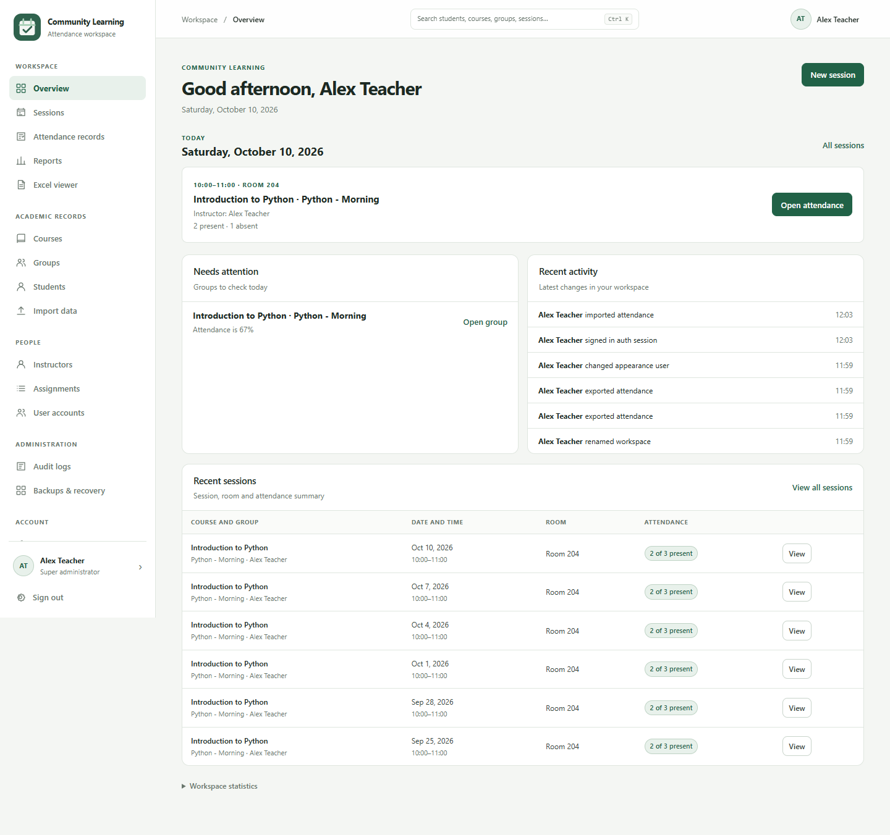
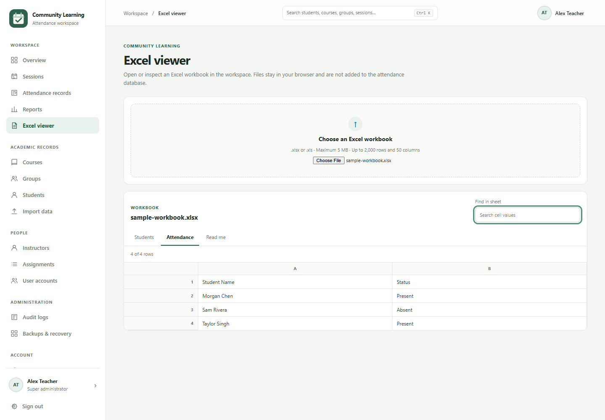
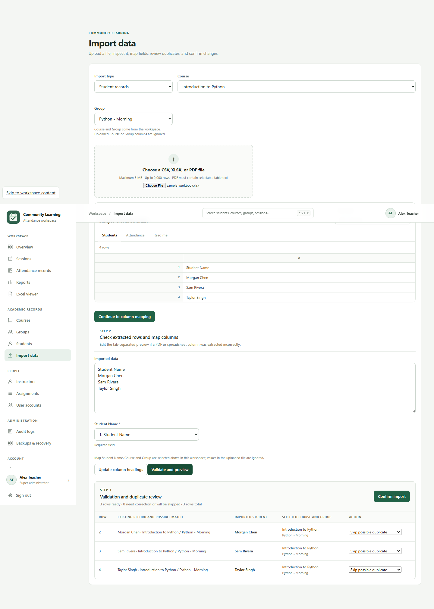

# Attendance Workspace

A self-hosted attendance application for classes, workshops, training programs, and community groups. Organize courses and groups, assign instructors, record attendance, and review or export reports from one workspace.

Each installation has its **own database, workspace name, and owner account**. Ordinary email/password accounts are supported; no university address or external account connection is required. Students are records, not login accounts.

[](https://github.com/MRL-creator/attendance-workspace/actions/workflows/ci.yml)
[](LICENSE)



## Features

- Courses → Groups → Students, with instructor assignments and session rosters.
- Session dates, start/end times, room, notes, and Present/Absent marks.
- Owner, administrator, instructor, and read-only viewer roles, enforced by the backend.
- Group attendance history, absence dates, dashboards, filters, and workspace search.
- In-app Excel viewer with worksheet tabs, formatted values, scrolling, and search.
- CSV/XLSX/selectable-text PDF imports: preview → manual mapping → validation → duplicate review → confirmation.
- CSV, multi-sheet XLSX, and printable PDF reports.
- Archived records, attendance name snapshots, audit history, and recovery snapshots for supported administrative deletions.
- Responsive interface, light/dark/system themes, and your own workspace name.

## Try it locally

**Requirements:** Node.js 24 or newer and npm. Cloudflare is used for production hosting; local development uses a local database.

```sh
git clone https://github.com/MRL-creator/attendance-workspace.git
cd attendance-workspace
npm ci
cp .env.example .dev.vars
npm run setup:key
```

On Windows PowerShell, use `Copy-Item .env.example .dev.vars`. If PowerShell blocks npm scripts, use `npm.cmd` and `npx.cmd` in the commands below.

1. Paste the generated random key into `BOOTSTRAP_KEY` in `.dev.vars`. Keep this file private.
2. Leave `ALLOWED_EMAIL_DOMAINS` blank to allow ordinary email addresses, or supply exact comma-separated domains.
3. Initialize and start the app:

   ```sh
   npm run db:local
   npm run dev
   ```

4. Open the localhost address shown by Wrangler. On **Create your workspace**, enter the setup key, workspace name, your name, email, and a password of 12–256 characters.
5. Sign in. Your account owns the workspace and can also teach sessions. Add staff accounts as needed.
6. Remove `BOOTSTRAP_KEY` from `.dev.vars` after setup and restart the development server.

The checked-in database ID is a placeholder for local development. Deployment commands refuse to use it. **Create your own D1 database before publishing.**

## Deploy your own installation

Follow the [Cloudflare deployment guide](docs/deployment.md) for account login, database creation, secrets, migrations, and launch checks. There is no shared public service: cloning this repository does not give access to anyone else's installation.

## Using the application

1. Create a course, then a uniquely named group belonging to that course.
2. Add students manually or import the supplied [sample CSV](examples/students.csv) / [sample workbook](examples/sample-workbook.xlsx).
3. Create staff accounts and assign instructors to the course/group combinations they teach.
4. Create a session. The current active students are copied into its roster, initially Absent.
5. Mark attendance, inspect group history, and use Reports for filtered exports.

See the [user guide](docs/user-guide.md) for roles, imports, reports, archival, and recovery. All screenshots and examples contain synthetic data.

### Access at a glance

| Role | Default scope | Changes |
| --- | --- | --- |
| Owner / super administrator | Whole installation | Workspace administration, staff roles, teaching, and all capabilities |
| Administrator | Whole installation | Manage records, assignments, reports, and supported backups; cannot manage other administrators without owner authority |
| Instructor | Assigned groups and accessible sessions | Create assigned sessions; change attendance for their own sessions; report export requires an extra permission |
| Viewer | Whole installation | Read-only; no mutations or report exports |

Administrators can grant selected extra instructor capabilities. Instructors do not become owners through an email address. Only first-run setup creates the owner.

## Development

```sh
npm test                 # Unit tests + Worker API tests with the real SQLite schema
npm run build            # Browser bundle and local PDF parser
npm run benchmark        # Reproducible group-history request/query comparison
npm audit                # Known dependency advisories
```

GitHub Actions runs these checks on pushes and pull requests. [CONTRIBUTING.md](CONTRIBUTING.md) explains the workflow and optional browser smoke check. [PERF.md](PERF.md) records measured efficiency improvements and their limits.

<details>
<summary>More screenshots</summary>





[First-run setup](docs/images/setup.png) · [Mobile settings](docs/images/mobile.png)

</details>

## Project details

- **Frontend:** vanilla JavaScript and CSS; esbuild splits the Excel parser into an on-demand chunk.
- **Backend:** Cloudflare Worker with server-side permissions, validation, and parameterized SQL.
- **Database:** Cloudflare D1 (SQLite), with a fresh schema and no seeded people or attendance.
- **File tools:** SheetJS CE for Excel, PDF.js for text extraction, browser print for PDF export.
- **Dependencies:** pinned by the lockfile; Excel comes from the versioned SheetJS distribution.

Read the [architecture](docs/architecture.md), [security notes](SECURITY.md), and [limitations](docs/user-guide.md#limits-and-non-goals) before using real student data. This is a single-organization application per installation, not a multi-tenant SaaS or a student portal.

## Background and license

This independent edition grew out of a club attendance application. It has neutral branding, configurable setup, independent configuration and history, and no preset staff identities or production database binding. The original club edition remains separate.

[MIT license](LICENSE). Contributions and reproducible bug reports are welcome; never include real student data or credentials in public issues.
