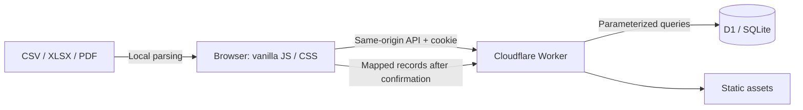

# Architecture

## Request and data flow

One Worker and one D1 database serve one organization. Different installations must use different databases. There is no tenant identifier or shared SaaS account model.

## Source map

| Location | Responsibility |
| --- | --- |
| `src/index.js` | Worker routing, authentication, permission checks, persistence, audit and backup operations |
| `src/client.js` | Application navigation, forms, workbook viewer, import flow and exports |
| `src/policy.js` | Role/capability predicates |
| `src/workspace-utils.js` | Optional new-account email-domain policy |
| `src/import-utils.js`, `public/csv.js` | File matrices, CSV parsing, name normalization and duplicate detection |
| `src/xlsx-viewer.js` | Bounded workbook parsing, cell display and import range validation |
| `src/attendance-utils.js`, `src/report-utils.js` | History and report calculations |
| `src/pdf-utils.js` | Reconstruction of rows from positioned PDF text |
| `migrations/0001_initial.sql` | Fresh schema, role/permission definitions and indexes; no people seeded |
| `tests/` | Logic tests, mock API tests, and real SQLite API regression tests |
| `scripts/` | Build, deploy guard, random setup key, sample generation and history benchmark |

## Persistence model

- A Course has Groups; each student belongs to a Group.
- Instructor assignments link user + course + group. Sessions reference those entities and an instructor.
- Attendance references the session and student key, with a saved student name for durable history. Deleting a student nulls the key without deleting the saved mark/name.
- User roles and optional additional permissions determine capabilities. Sessions store only token hashes; passwords store salted PBKDF2-SHA-256 output.
- `workspace_settings` contains one row (`id=1`) with the installation name. Its unique insert is the first statement in the same D1 batch that creates the first owner, so concurrent setup cannot create another owner. [D1 batch semantics](https://developers.cloudflare.com/d1/worker-api/d1-database/#batch) provide rollback if any statement fails.
- Audit and supported recovery snapshots reside in D1. They require an operator-defined retention/backup policy.

## File processing

SheetJS and PDF.js load only when needed. Files are read locally; file binaries are not sent to the server. Import confirmation sends mapped JSON records that the Worker validates again. Report data comes from the authorized API; XLSX generation and PDF printing happen in the browser.

SheetJS reads a bounded row range. The original range is retained and checked separately before import, avoiding silent truncation. The viewer is intentionally limited and does not execute formulas or macros. Compressed files can still consume browser resources: file-size and preview limits do not guarantee safe handling of every malicious archive.

## Efficiency

Group history uses one scoped bulk attendance query rather than one API request per session. The client groups returned rows by session using a Map. Session and history selection use the same deterministic date/time/ID ordering and latest-500 limit. The bulk response rejects more than 50,000 marks instead of showing incomplete totals.

See [PERF.md](../PERF.md) for measurements and remaining work. The inherited route/client modules remain relatively large; splitting them is a reasonable future maintenance change, but this edition preserves functioning workflows rather than performing an unrelated rewrite.
